= PC6001VX Manual
eighttails <http://eighttails.seesaa.net>
:toc-title: Contents
:toc: left
:numbered:
:data-uri:
:icons: font

== Introduction
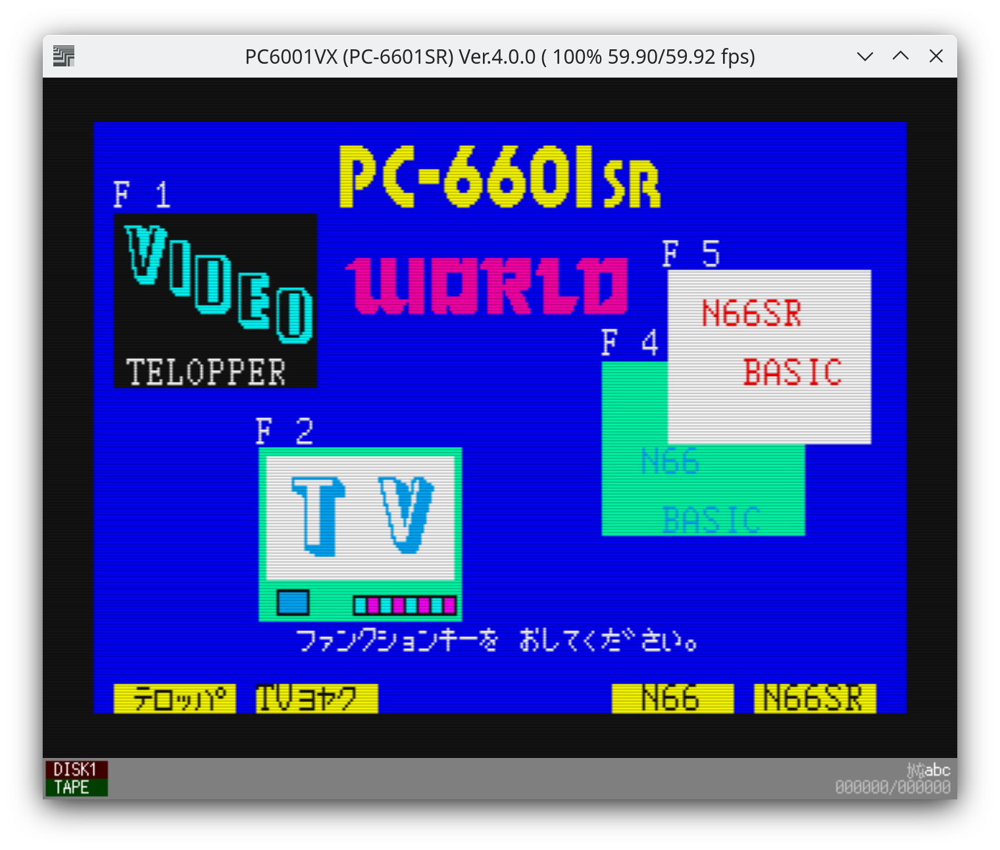

This program is a port of PC6001V, a PC-6001 emulator created by http://papicom.net[Yumitaro], modified to run on Linux and other platforms. +
The X at the end of PC6001VX stands for cross-platform. +
The targets are UNIX-like OSes such as Linux and Android. As a portability check we also release Windows binaries. +

== Getting Started
=== Requirements
* ROM files +
In principle, the emulator requires ROM files dumped from a real PC-6001 series machine. See http://p6ers.net/hashi/suidashi.html[here] for instructions on how to dump them from real hardware. +
If you do not own a real machine, another option is to use the compatible ROM created by http://000.la.coocan.jp/p6/basic.html[Akikawa]. The compatible ROM is embedded in the emulator binary and can be enabled in the settings. +
When using the compatible ROM, the behavior corresponds to the original PC-6001, PC-6001A, PC-6001mk2 or PC-6601. PC-6001mk2SR and PC-6601SR can also be selected, but BASIC mode 6 is not supported. Choose them when you want to speed up software that only uses modes up to 5 by turning bus requests off. +
The required ROM files are listed below. +
[WARNING]
On platforms other than Windows, the emulator will fail to start if the letter case of the file names is wrong. Please be careful. 

** PC-6001
+
[options="header"]
|================
|File name|Size|CRC32|Corresponding ROM
|BASICROM.60|16KB|54C03109|N60-BASIC interpreter ROM
|CGROM60.60|4KB|B0142D32|N60-BASIC CGROM
|================

** PC-6001A
+
[options="header"]
|================
|File name|Size|CRC32|Corresponding ROM
|BASICROM.61|16KB|FA8E88D9|N60-BASIC interpreter ROM
|CGROM60.61|4KB|49C21D08|N60-BASIC CGROM
|================

** PC-6001mk2
+
[options="header"]
|================
|File name|Size|CRC32|Corresponding ROM
|BASICROM.62|32KB|950AC401 +
D7E61957|N60m-BASIC interpreter ROM(*1)
|CGROM60.62|8KB|81EB5D95|N60-BASIC CGROM
|CGROM60m.62(*2)|8KB|3CE48C33|N60m-BASIC CGROM
|KANJIROM.62|32KB|20C8F3EB|KANJI ROM
|VOICEROM.62|16KB|49B4F917|Speech synthesis ROM
|================
*1 Two different versions of BASICROM.62 for PC-6001mk2 are known to exist. +
Both are version 1.7, but some minor bug fixes seem to have been made.  +
*2 Note that the "60m" in the file name is lower case.

** PC-6601
+
[options="header"]
|================
|File name|Size|CRC32|Corresponding ROM
|BASICROM.66|32KB|C0B01772|N66-BASIC interpreter ROM
|CGROM60.66|8KB|D2434F29|N60-BASIC CGROM
|CGROM66.66|8KB|3CE48C33|N66-BASIC CGROM
|KANJIROM.66|32KB|20C8F3EB|KANJI ROM
|VOICEROM.66|16KB|91D078C1|Speech synthesis ROM
|================

** PC-6001mk2SR
+
[options="header"]
|================
|File name|Size|CRC32|Corresponding ROM
|SYSTEMROM1.64|64KB|B6FC2DB2|N66/N66SR-BASIC ROM
|SYSTEMROM1.64|64KB|55A62A1D|Speech synthesis, KANJI and other ROMs
|CGROM68.64|16KB|73BC3256|BASIC CGROM
|================

** PC-6601SR
+
[options="header"]
|================
|File name|Size|CRC32|Corresponding ROM
|SYSTEMROM1.68|64KB|B6FC2DB2|N66/N66SR-BASIC ROM
|SYSTEMROM1.68|64KB|55A62A1D|Speech synthesis, KANJI and other ROMs
|CGROM68.68|16KB|73BC3256|BASIC CGROM
|================

* Expansion cartridges
+
ROMs of some genuine expansion cartridges are also treated as system ROMs. +

** PCS-6001R Extended BASIC
+
[options="header"]
|================
|File name|Size|CRC32|Corresponding ROM
|EXBASIC.ROM|8KB|TBC|N60 Extended BASIC ROM
|================

** PC-6601-01 Extended KANJI ROM cartridge
** PC-6007SR Extended KANJI ROM&RAM cartridge
+
[options="header"]
|================
|File name|Size|CRC32|Corresponding ROM
|EXKANJI.ROM|128KB|TBC|Extended KANJI ROM
|================

** (Not supported) PC-6053 Voice Synthesizer
+
[options="header"]
|================
|File name|Size|CRC32|Corresponding ROM
|EXVOICE.ROM|8KB|TBC|Speech synthesis ROM
|================

* WAV files +
On mk2 and later models, the fixed words of the speech synthesizer must be provided as WAV files. +
Run `talk"f41."` on a real machine in mode 5 or 6 and record the audio under the name f41.wav. +
Prepare f42~f44.wav in the same way. +
As for the WAV format, the author has verified operation with 44kHz mono WAV files. +
Without the WAV files, the fixed words will not be played. +

=== First-time Setup
Once the required files are ready, start PC6001VX. For how to launch it, refer to the platform specific information matching your OS. +
On the first start you should see the following error. +

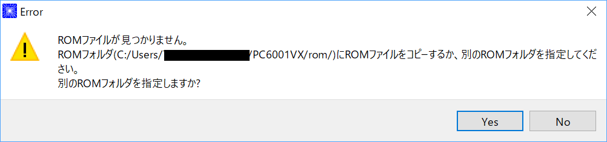

The emulator looks for the ROM files inside the folder shown here, so copy the ROM files to that location, or, if your ROM files are already stored somewhere else, you can change the setting to point there. To change the setting, click "Yes" and specify the folder where the ROM files are located. +

If you click "No" here, the following dialog is shown. +

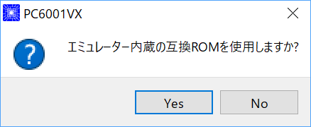

Choosing "Yes" here starts the emulator with the compatible ROM built into the binary. Use this if you do not have ROMs dumped from real hardware. +
By default the emulator behaves like a PC-6001, but you can also select a PC-6601 equivalent ROM in the settings dialog.

If the CRC of the specified ROM file does not match the commonly known one, the following message is displayed. +

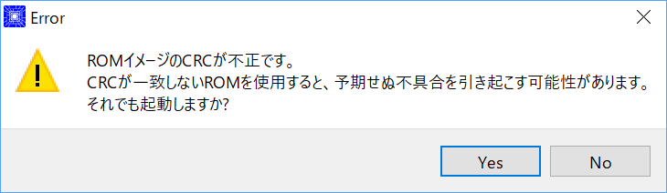

You will be warned, but clicking "Yes" makes the emulator start from then on without checking the ROM CRC. +
From that point on, however, everything is at your own risk. +

=== Command Line Options
PC6001VX supports command line options. +
The following options are available. +
[options="header"]
|================
|Option|Argument|Description
|-l +
--loadstate |(state file name)| Loads the given state file ("どこでもLOAD" file) at startup.
|-v +
--version |(none)| Show version information.
|-h +
--help |(none)| Show help.

|================

=== Platform Specific Information
==== Windows
* How to start +
Simply double-click PC6001VX.exe.
* If it does not start +
** Delete the ini file. +
* Where settings and generated files are stored +
The ini file and various folders are created in the same folder as the exe file.

[WARNING]
The configuration file is not compatible with PC6001VX Ver.3 and earlier. +
Install into a different folder instead of overwriting, or delete the ini file before starting.

==== Linux
* How to start +
Build from source and run it. See the developer information chapter for how to build. +
* Where settings and generated files are stored +
The ini file and various folders are created under the ~/.pc6001vx4 folder. +

==== Android
* How to start +
Tap the PC6001VX icon registered in the application menu. +
* Where settings and generated files are stored +
On Android the location of the configuration files depends on the device and cannot be stated in general, but it is usually created in a place normal file managers cannot access. Check the exact location in the preferences dialog. +
* Sharing files +
On Android files cannot be written directly outside of the app sandbox. When you take a snapshot or export a TAPE(SAVE) image, a share menu is shown and you can send the file to any app such as a file manager or an image editor. +

== Usage
=== Menu
Right-click on the main emulator screen to show the menu. +
On Android, tap on the main screen to bring up the menu. +

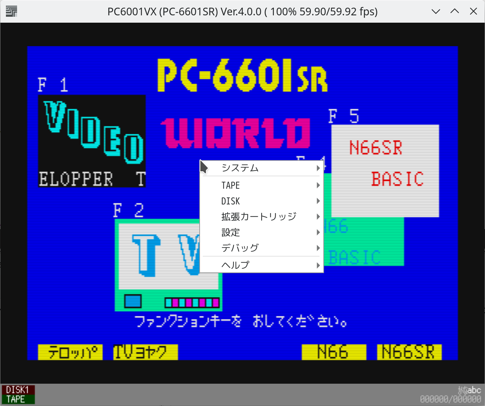

* System +
** Reset +
Resets the emulator. +

** Restart +
Restarts the emulator. +
A restart is required to apply configuration changes. +

** Pause +
Pauses the emulator.
** Disable wait +
Disables the emulator's wait states and runs it at full speed. +

** Take snapshot +
Saves the current emulator screen as an image file. +
The destination is the folder configured under "SnapShot" on the "Folder" tab of the settings dialog. +

** Speed control +
Adjusts the emulation speed. +
Several presets are provided in the menu, and you can also enter a value between 10% and 2000%. +

** State load +
** State save +
Saves the entire state of the P6 as-is so you can resume it later. +
It is similar to the resume/suspend feature of laptops. +
The save file can have any name (.ddr), and there are also slots 1 to 3. +
The data of slot 1 is saved as (state save folder)/1.ddr, and likewise for slots 2 and 3. +
[WARNING]
This feature is still far from complete. It does not consider cases such as writing to TAPE or DISK at all, so it may well destroy your images. Be careful.
[WARNING]
State save files contain the contents of memory. Do not distribute them without the copyright holder's permission.

** Replay +
The replay menu changes depending on the current state. +
*** [Normal] +
**** Playback +
**** Record +
**** Resume recording +
If a resume file was left when a previously recorded replay ended, "Resume recording" lets you continue recording that replay from where recording stopped.
**** Convert replay to movie +
Converts a saved replay file to a movie. +
First select the replay file to convert, then specify where to save the movie. +
Then playback of the replay and encoding of the movie start together. When the replay ends, the movie encoding finishes automatically.

*** [Playing] +
**** Stop playback +
Stops replay playback.

*** [Recording] +
**** Stop Recording +
Stops recording. +
When stopping, a "(replay file name).resume" file is left, just like with a checkpoint. +

**** Checkpoint +
While recording a replay, you can save the current point in the recording. +
A "(replay file name).resume" file is left in the same folder as the replay file (.ddr). +

**** Back to checkpoint +
If you fail while recording a game replay, you can return to the last "checkpoint" without stopping the replay recording and try again. +

**** Back to previous checkpoint +
If you fail while recording a game replay, sometimes even rewinding with "Back to checkpoint" leaves you stuck at the checkpoint. Up to 5 checkpoints of history are kept, so you can redo from the previous checkpoint. +
If you use this, the most recent checkpoint is lost. +

** Video capture +
Records the emulator's operation as a movie file. +
To stop recording, select this menu again (it changes to "Stop video capture"). +
The movie is recorded in WebM format. (MP4 support has been skipped due to licensing risks.) It is not a widely used format, but YouTube supports it officially. +
During recording the emulation speed drops drastically (about 1/10 on the author's machine), so it is currently impossible to play a game while recording. +
The intended workflow is to record your play as a replay first, then play back the replay while recording a movie. (If the replay ends during recording, the movie recording ends at that point.) +
Regardless of the machine's speed, the resulting movie is 60FPS. +

** Key panel
+
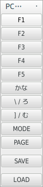
Shows an auxiliary key panel with buttons for keys that are often impossible to enter on English keyboards or mobile device keyboards. +
The buttons also work while the shift key is held. Pressing the F1 button while holding shift acts as the F6 key. +

** Virtual keyboard
+
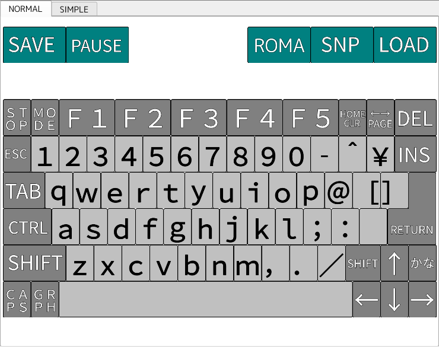
Shows a virtual keyboard usable on touch screens. +
The NORMAL tab shows a layout imitating the real keyboard, and the SIMPLE tab shows a layout simplified for games. +
The buttons above the virtual keyboard are shortcuts to frequently used functions. +
*** SAVE +
State save (uses slot 1) +
*** ROMA +
Toggle Romaji input +
When Romaji input is on, an "R" is shown in the status bar (enabled by default) +
*** PAUSE +
Pause the emulator +
*** SNP +
Save a snapshot +
On Android this shares the image with other apps. Sending it to some file manager apps such as https://play.google.com/store/apps/details?id=com.lonelycatgames.Xplore&hl=ja[X-plore File Manager] lets you save the image to the SD card. +
*** LOAD +
State load (uses slot 1) +

+
[WARNING]
====
* Verified to work on Android and Windows11.
* When a key is held down, input repeats at a timing close to the real machine's key repeat.
* To operate the NORMAL mode properly you probably need a screen of at least 5 inches.
* On Windows11, turn off emulator fullscreen and switch to tablet mode for a natural look.
====

** Auto typing +
This feature types input automatically from a text file. +
Supported files follow the txt2bas specification. +

** Exit +
Quits PC6001VX. +

* Tape +
Insert and eject tape images. +
The supported image format is P6T, but P6 and CAS format files can also be mounted. +

** Insert... +
Mounts a tape image file. +

** Eject +
Ejects the tape image file. +

** Export saved TAPE... +
The SAVE tape image is stored as a separate file from the LOAD one, and you can save that file under any name in any folder. +
On Android this shares the file with other apps. Sending it to some file manager apps such as https://play.google.com/store/apps/details?id=com.lonelycatgames.Xplore&hl=ja[X-plore File Manager] lets you save the TAPE image to the SD card. +

* Disk +
Insert and eject disk images. +
The supported image format is d88. +
The file selection operation is the same as for TAPE. +

* Extended ROM +
Select an extended ROM. +
For PC-6006 or Warrior's Cartridge, this inserts/ejects the ROM image installed in the cartridge. +
If you want a 32KB configuration on the original machine, choose "no ROM" for PC-6006. +
The file selection operation is the same as for TAPE. +

* Joystick +
If a joystick is connected, configures the assignment to P6 joystick ports 1 and 2. +

* Settings +
** Display size +
*** 50%~300% +
Changes the display magnification. +

*** Specify magnification... +
You can enter a number directly to display at any magnification. +

*** Fix magnification +
Normally the display magnification follows changes of the window size, but when this checkbox is on, the display size stays fixed regardless of the window size. +

** Full screen +
Switches to fullscreen mode. +

** Status bar +
Toggles the status bar visibility. +

** 4:3 TV display +
Generally the aspect ratio of PC pixels is 1:1. +
On a TV, however, it is 1.16:1, i.e. a bit taller. +
So displaying it as-is on a PC results in a stretched-wide image. +
4:3 display shrinks the horizontal direction by a factor of 1.16 to compensate. +

** Scanline +
The horizontal frequency of the P6 is 15kHz, the same as a TV. +
TVs use an interlace scheme where scan lines are split into even and odd fields and displayed alternately. +
However, most computers including the P6 use a non-interlace scheme where even and odd scan lines scan the same position, in order to reduce flicker. +
In this case the number of scan lines is halved, leaving gaps between the scan lines. +
Scanline mode reproduces these gaps. +
To achieve scanline mode in an emulator you need twice the screen resolution of the real machine (640x400 or more where the real machine is 320x200). +
Naturally the display becomes heavier and processing speed drops. +

** Filtering +
Applies filtering when the graphics are magnified or shown in 4:3. It is on by default. +
This is meant to make non-integer magnifications look natural, but if you dislike the blurry look, you can get a crisp pixel display by following the steps below. +

. Turn filtering off. +
. Turn 4:3 display off. +
. Set the display size to an integer multiple. +

** Tilt mode +
+
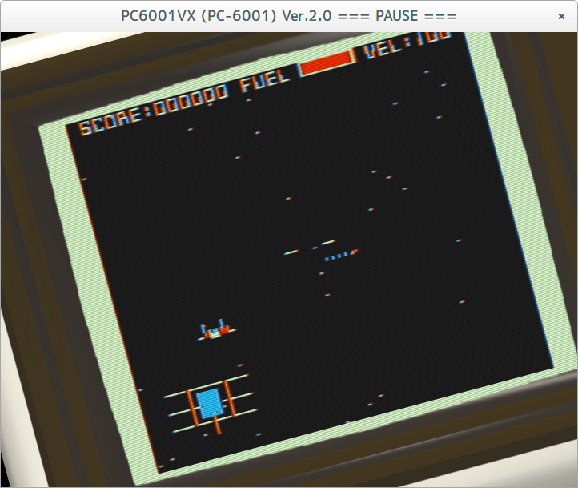
A joke feature inspired by the 3DS version of Space Harrier. +
The screen tilts in response to the joystick or the left/right cursor keys. (; +
In fullscreen mode, or when the status bar is hidden, a display frame is shown. The original machine shows a PC-6042, others show a PC-60m43. +

** Mode4 color +
Selects the color bleeding of screen mode 4 in BASIC modes 1-4. +

** Frameskip +
Specifies the emulator's frameskip interval. +

** Romaji input +
Toggles Romaji input on/off in KANA mode. +

** Turbo tape +
Runs without wait states while reading TAPE. +
It is only unthrottled while the relay is ON and returns to normal speed as soon as the relay turns OFF. +
Since it simply runs at full speed, timing is less likely to change and it is reliable, but on slow machines it may not produce a sufficient effect. +

** Boost up +
The TAPE transfer rate is 1200 baud, which seems to be determined by the reliability of the TAPE medium and the processing power of the sub CPU. +
The main CPU (Z80) apparently has headroom and there is quite a lot of waiting. +
By monitoring the BASIC work area and sending the next data as soon as the machine starts waiting, wasted wait time is reduced and loading becomes efficient. +
In the author's tests, roughly 9x on N60 and 5x on N60m were achieved. +
The limit differing by BASIC mode is presumably due to differences in internal processing. +
The maximum factor can be changed under [Settings]-[Preferences]-[Other]. +
While it reliably speeds things up, timing-sensitive software may drop data, and custom loaders that do not use ROM routines may not work with it at all. +
It is not a cure-all, so use it selectively. +

** Preferences... +
Shows the preferences dialog. See the Preferences chapter for details. +

* Debug +
** Monitor mode +
+
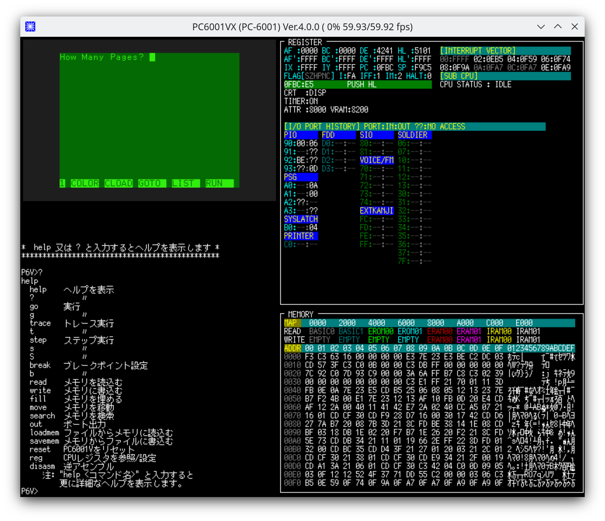
A mode where you can inspect registers and memory and step through execution for debugging. +
Type "?" to show the help. +

* Help  +
** Online help +
Shows the online manual. +
The manual bundled with the app is shown in your browser: on Windows the local HTML file, on AppImage the HTML bundled inside the AppImage; in other environments a locale-specific page on GitHub is shown. +

** About... +
+
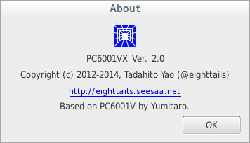
Shows the About dialog. +

** About Qt +
Shows the version of Qt embedded in PC6001VX. +

** System Information... +
Shows information about the environment PC6001VX is currently running on (for bug reports). +
Pressing the "Copy" button copies the text to the clipboard. +

** Reset settings... +
Restores the settings to their defaults. +
The program has to exit after the reset, so start it again afterwards.

=== Romaji input
While in KANA input mode, [ALT]+[F12] switches between Romaji and KANA input. (Romaji input is enabled by default) +
Either hiragana or katakana is fine. +
When Romaji input is enabled, an "R" is shown in the kana indicator of the status bar. +
The Romaji-to-kana mapping mostly follows Google Japanese Input. +

.Special symbols in Romaji input
[options="header"]
|=================================
|Character|Key
|ー|-
|「|[
|」|]
|。|.
|、|,
|・|/
|=================================

=== Keyboard Shortcuts
.Keys specific to the PC-6001 series
[options="header"]
|=================================
|Key|Function
|[ALT]|GRAPH
|[PageUp] +
[CTRL]+[F8]|PAGE(↓↑)
|[End] +
[CTRL]+[F9]|STOP
|[PageDown] +
[CTRL]+[F10]|MODE
|[ScrollLock] +
[CTRL]+[F11]|CAPS
|[Pause] +
[Katakana/Hiragana] +
[CTRL]+[F12]|Kana
|=================================

.Various function keys
[options="header"]
|=================================
| Key | Function
|[F6]|Monitor mode
|[ALT]+[F6]|Toggle fullscreen
|[F7]|Toggle scanline
|[ALT]+[F7]|Toggle 4:3 display
|[F8]|Toggle mode4 color
|[ALT]+[F8]|Toggle status bar
|[F9]|Pause (toggle)
|[ALT]+[F9]|State save (uses slot 1) +
Checkpoint while recording a replay
|[F10]|Wait (toggle)
|[ALT]+[F10]|State load (uses slot 1) +
Back to checkpoint while recording a replay
|[F11]|Reset
|[ALT]+[F11]|Restart
|[F12]|Snapshot
|[ALT]+[F12]|Toggle Romaji input
|[Muhenkan]|State save (uses slot 1) +
Checkpoint while recording a replay
|[Henkan]|State load (uses slot 1) +
Back to checkpoint while recording a replay
|=================================

=== Mouse Operations
If you use a mouse with a wheel, you can change the emulation speed. +
Wheel up speeds up, wheel down slows down, and clicking the middle button returns to normal speed. +
The speed changes in steps of 10% up to 2x, and in steps of 100% above 2x. +

.Mouse button operations
[options="header"]
|=================================
| Operation | Function
|Left double-click|Toggle fullscreen
|Right-click|Show menu
|Middle click|Reset emulation speed to 100%
|Wheel up|Increase speed (up to 20x)
|Wheel down|Decrease speed (down to 0.1x)
|=================================

Note that on Android only left clicks are delivered to the application, so mouse operations differ.

.Mouse button operations (Android)
[options="header"]
|=================================
| Operation | Function
|Left click|Show menu
|=================================

Also, dragging & dropping files onto the main screen does the following.

.Drag & drop behavior
[options="header"]
|=================================
|Extension|Description
|p6t,p6,cas|Mount tape image (LOAD only)
|d88|Mount disk image in drive 1
|rom,bin|Mount extended ROM image
|dds|Load state save file
|ddr|Load replay data file
|bas,txt|Load auto typing file
|=================================

=== Preferences

Choose [Settings]-[Preferences...] from the menu to show the preferences dialog. +
A restart is required to apply configuration changes. +

* Basic +
Settings of the emulated model and its configuration. +
+
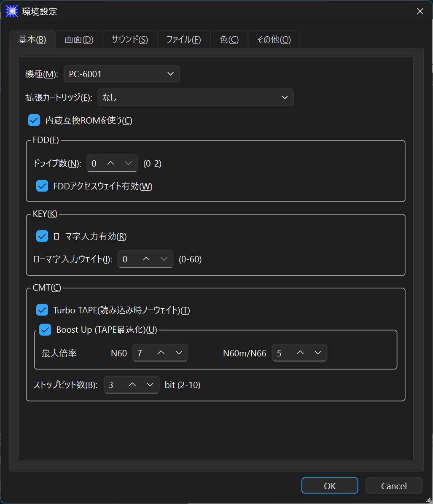

** Model +
Selects the model to emulate. +
Running it requires ROMs dumped from the selected model. +
When using the compatible ROM, choose PC-6001, PC-6001mk2 or PC-6601. +

** Expansion cartridge
Specifies the type of expansion cartridge to use. +

** Use built-in compatible ROM +
Uses the compatible ROM created by http://000.la.coocan.jp/misc.html[Akikawa]. +
The compatible ROM is embedded in the emulator binary, so no extra files are needed. +
+
[WARNING]
====
The compatible ROM does not implement every feature of the genuine ROM. +
Due to missing features and differences in the CGROM typefaces, behavior and the appearance of the screen may differ from the genuine ROM.
====

** FDD
*** Number of drives +
Sets the number of connected FDDs. +

*** Enable FDD access wait +
Makes the emulator insert wait states on FDD access. +

** KEY
*** Enable Romaji input +
When enabled, you can type in Romaji while in KANA input mode. +
The Romaji-to-kana mapping mostly follows Google Japanese Input. +
*** Romaji input wait +
Depending on the software, input of the second and later characters may be dropped. +
(the voiced mark of "か゛" or the "ゃ" of "りゃ" etc.) +
In that case increase the Romaji input wait value. +
So far this symptom is known to occur in Portopia Serial Murder Case, and it goes away with the Romaji input wait set to about 20.

** CMT
*** TurboTape +
Runs without wait states while reading TAPE. +

*** BoostUp +
Specifies the maximum speed factor of the tape loading speedup feature. +

*** Stop bits +
Sets the number of stop bits used on tape access. +

* Screen +
Screen related settings. +
+
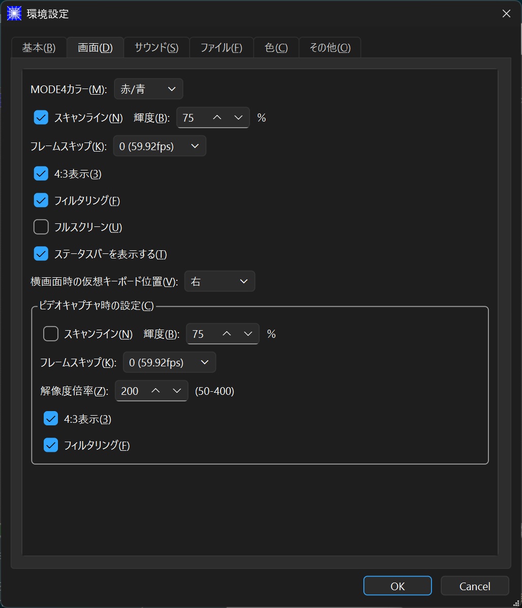

** Mode4 color +
Selects the color bleeding of screen mode 4 in BASIC modes 1-4. +

** Show scanline +
Reproduces the gaps between scan lines. +

** Frameskip +
Specifies the frameskip interval. +

** 4:3 display +
Shrinks the screen horizontally by a factor of 1.16 so that the overall aspect ratio becomes 4:3. +

** Filtering +
Applies filtering when the screen is magnified, making it smoother. +

** Fullscreen +
Turns fullscreen on. +

** Show status bar +
Shows the status bar. +

** Virtual keyboard position in landscape screen +
Specifies the layout when the screen is rotated to landscape while the virtual keyboard is shown. +
Setting it to "Hidden" hides the virtual keyboard in landscape orientation only. +
For 2in1 tablets with a physical keyboard attached, "Hidden" is recommended.

** While capturing video
Different settings can be applied during video capture than during normal operation. +
By default +
*** scanline off (so as not to degrade video quality) + 
is configured. +

* Sound +
Sound related settings. +
+
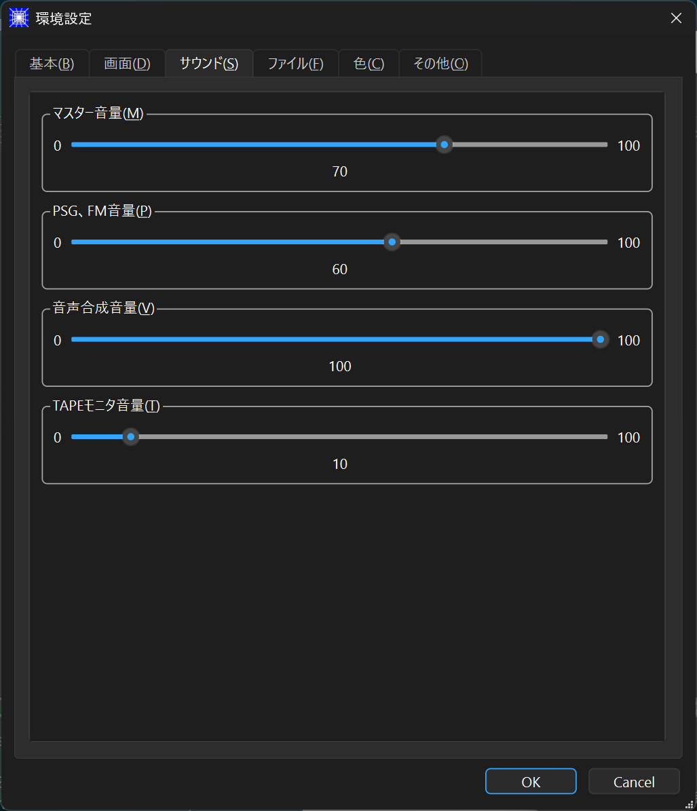

** Master volume +
Specifies the overall volume. +

** PSG, FM volume +
** Speech synthesis volume +
** Tape monitor volume +
Specifies the volume of each sound source. +

* File +
Specifies the files to mount in the emulator. +
Files specified here stay mounted even after the emulator is restarted. It is handy to configure them when you keep using the same images during development. +
+
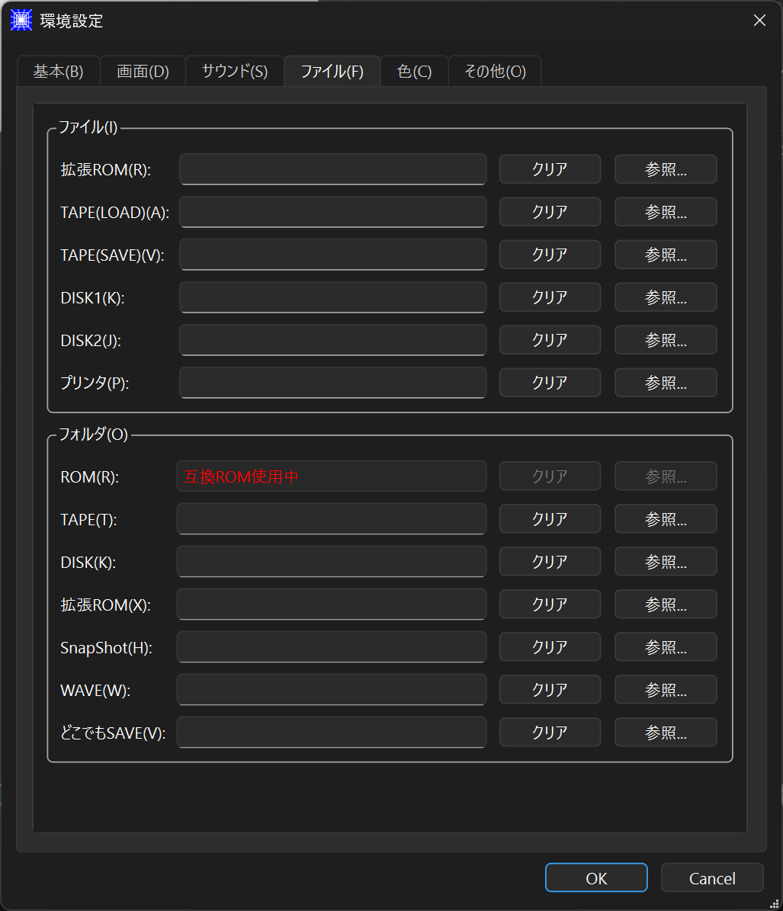

** Files
*** Extended ROM +
If you use an extended ROM, specify its file. +

*** Tape(Load) +
To prevent corruption, tape images use separate files for reading and writing. +
Tape(Load) specifies the tape image file used for reading. +

*** Tape(Save) +
Specifies the tape image file used for writing. +

*** Disk1 +
*** Disk2 +
Specifies the disk image files mounted in each drive. +

*** Printer +
Specifies the file where printer output is written. +

+
[NOTE]
====
On Android the TAPE(Save) file and printer cannot be configured.
====

** Folder +
Specifies the folders used when searching for and saving files. +

*** ROM +
The folder where ROM files dumped from real hardware are placed. +
+
[NOTE]
====
This cannot be configured while using the compatible ROM.
====
*** Tape +
The starting folder when opening tape image files. +

*** Disk +
The starting folder when opening disk image files. +

*** Extended ROM +
The starting folder when opening extended ROM files. +

*** SnapShot +
The folder where snapshot image files saved with the F12 key are stored. +

*** WAVE +
The folder where the files recording the fixed words of the TALK statement are placed. +

*** State save +
The folder where state save files are stored. +

+
[NOTE]
====
On Android, folders other than ROM and WAVE cannot be configured.
====

* Color +
You can customize the colors shown on the emulator screen. +
Click a color you want to change to open a color selection dialog, and pick any color. +
+
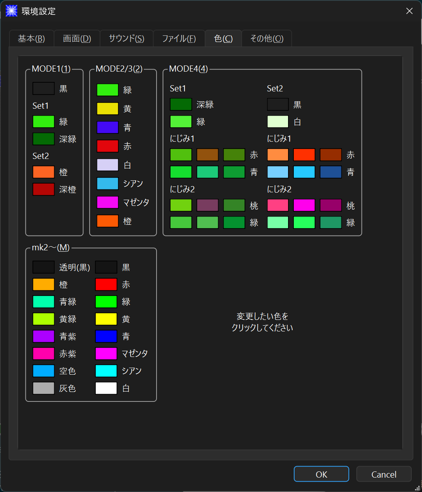

* Other +
Settings about the emulator's behavior. +
+
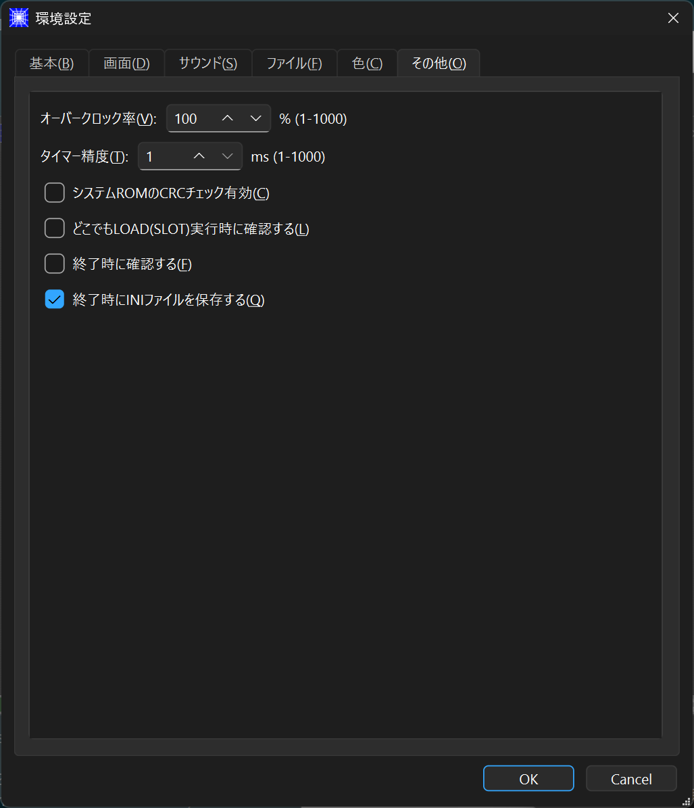 

** Overclock rate +
Specifies the speed multiplier. +

** Timer precision +
Depending on the OS, the timer used for internal speed adjustment may be too coarse to reach 60FPS. +
If the measured speed is slower than expected although the CPU power seems sufficient, increase this value. +
The default is 1ms and normally there is no need to change it. +

** Enable CRC check for the System ROM +
Performs a ROM CRC check at startup. +
If the CRC check fails, a warning is shown at startup. +
Turn this off if the CRC does not match for some reason, or when using the compatible ROM. +

** Confirm at state load +
A confirmation dialog is shown when executing state load (SLOT). +

** Confirm at exit +
A confirmation dialog is shown when exiting. +

** Save the INI file when quit +
Saves the INI file at exit. +
If this check is off, configuration changes made from the menu are no longer saved. +

== Developer Information
=== License
Following the license of the original PC6001V, this program is licensed under the LGPL. +
However, the FMGEN part follows the license set by http://retropc.net/cisc/m88/[CISC], which permits its use only in freeware.
The author eighttails is not responsible for any damages caused by using this program.

=== How to Build
==== Windows
Build on the MSYS2 environment. +

. Download and install MSYS2 from https://github.com/msys2/msys2-installer/releases/[here]. +
VC++ is not supported. +
MSYS2 packages update quickly and upgrades very often cause regressions, so it is recommended not to update packages (`pacman -Sy`) and to keep the versions fixed. The author has verified building and running with the environment built from the following installer (64-bit). +
https://github.com/msys2/msys2-installer/releases/download/2026-03-22/msys2-base-x86_64-20260322.sfx.exe
. Run ucrt64.exe in the folder where MSYS2 was installed. +
. Extract the downloaded PC6001VX sources into the home folder on MSYS. +
. Run `cd PC6001VX/win32` to move the current directory to the win32 folder of the source folder. +
. Run `bash ./release.sh`. It installs the required tools (QtCreator, SDL2, asciidoctor), builds the static Qt/FFmpeg, does a Release build with CMake and creates the distribution folder, all in one go. +
The static Qt is placed at `/ucrt64/local/qt6-static-private`. +
. `release.sh` internally uses `buildrelease.sh` to Release-build the root `CMakeLists.txt` with Ninja + CMake. The distribution EXE is output to `PC6001VX_release/PC6001VX_(version)_win_64bit`. +
. If you modify and debug the sources yourself, open the root CMakeLists.txt in QtCreator and build with a kit using MSYS2 UCRT64 + the static Qt. How to configure the kit is out of scope of this manual. +

==== Linux
This section covers Debian based distributions. +
Building requires Qt6.4.0 or above. +
[NOTE]
====
Depending on the distribution and its version, Qt6 may not be packaged yet. In that case use the official Qt installer.
====

. In your shell run `apt install build-essential cmake ninja-build libx11-dev libsdl2-dev qtcreator qt6-base-dev qt6-multimedia-dev qt6-declarative-dev libavformat-dev libavcodec-dev libswscale-dev`. +
. Extract the downloaded PC6001VX sources. +
. Open the root CMakeLists.txt in QtCreator and build. +
. Without an IDE, you can build from the command line with the following steps. +
[source,bash]
----
cd PC6001VX
cmake -S . -B build -G Ninja -DCMAKE_BUILD_TYPE=Release
cmake --build build
----

==== Android
Set up the environment following http://qt-project.org/doc/qtcreator/creator-developing-android.html[these instructions]. +
Qt 6.5.0 or above is required. +

== Known Issues and Limitations
* Windows
** On Windows11, switching kana with the Katakana/Hiragana key does not seem to work. +
Use the PAUSE/CTRL+F12 key, or show the key panel to switch kana.

== Change Log
.4.6.0 2026/11/02
* Separated the manual into a Japanese version (README_J.adoc) and an English version (README.adoc).
* The online help now follows the UI language: the Japanese manual is shown when the language is Japanese, and the English manual otherwise.
* (Windows) Bundle the English HTML manual along with the Japanese one.
* (Linux) The AppImage now bundles the online manual HTML (Japanese and English) and shows the local manual in the browser instead of GitHub.

.4.5.1 2026/10/02
* (Linux) Fixed backward compatibility so that the build works on Ubuntu22.04LTS.
* (Linux) Fixed the issue where multilingual support was not working
* (Android) Fixed an issue where menu text was truncated.

.4.5.0 2026/09/09
* Changed screen rendering from QGraphicsView/QGraphicsScene based implementation to QML/Qt Quick based implementation.
* Changed the virtual keyboard to a QML/Qt Quick based implementation and removed dependency on Qt Graphics Scene (QGraphics* classes).
* Added key repeat support to the virtual keyboard.
* Removed the hardware acceleration setting and safe mode along with the migration to QML/Qt Quick.
* (Android) Restored the ability to share snapshots and TAPE(SAVE) exports with other applications, which had been unavailable due to changes in Qt.

.4.4.0 2026/08/15
* Migrated to cmake-based build and removed .pro file for qmake.
* Updated PC-6001 compatible BASIC to 0.8.2
* Updated compatible BASIC for PC-6001mkII/6601 to 0.5.3. Basic mode 6 is not supported, but software up to mode 5 can be sped up by turning off bus requests.
* Supported FFMpeg 9 (can be built with FFMpeg 7, 8, 9) (thanks to bevanjkay)

.4.3.0 2025/11/23
* Added command line option to automatically load arbitrary state file at startup.
* Supports switching of sound output devices.
* Added key assignment that can be entered with CTRL + function keys.
* Fixed TILT mode not supporting joystick.
* Fixed an issue where input on the English keyboard was wrong.
* (Linux) Started offering of AppImage format.
* (Android)Updated SDK Version to 36.(Re-fix)

.4.2.14 2025/08/30
* Fixed a case where replays of Roman alphabet inputs may not be reproduced correctly.
* (Android)Updated SDK Version to 36.

.4.2.13 2025/06/06
* Updated PC-6001 compatible basic ROMs to 0.8.1.
* Updated PC-6001mk2/6601 compatible basic ROMs to 0.5.2.

.4.2.12 2025/04/06
* Merged upstream PC6001V version 2.1.4.
* Fixed an issue where lower case file names could not be used with debugger savemem,loadmem command.

.4.2.11 2025/02/10
* Fixed freezes when playing FM synthesizer.
* Fixed joystick settings not saved.

.4.2.10 2024/12/15
* Fixed an issue where the status bar may become garbled.
* Fixed an issue where sound might not play.
* (Windows) Fixed an issue where the menu may not be displayed when in full screen.

.4.2.9 2024/07/20
* Improved stability of sound playback.

.4.2.8 2024/06/23
* Fixed freezing on termination when building with Qt6.7

.4.2.7 2024/06/23
* Merged upstream PC6001V version 2.1.3.
* Updated PC-6001 compatible basic ROMs to 0.8.

.4.2.6 2024/06/10
* Updated PC-6001mk2/6601 compatible basic ROMs to 0.5.1.
* Compatible with FFmpeg7 (currently buildable with versions 5, 6, and 7)
* (Android)Fixed an issue where the screen layout may be corrupted when restarting.

.4.2.5 2023/12/23
* Fixed screen layout sometimes not updating when enabling/disabling virtual keyboard.
* Fixed an issue where the menu appearance position during touch operation was incorrect.

.4.2.4 2023/11/15
* Virtual keyboard position in landscape screen is now configurable.
* Made config dialog scrollable.(for small screen)

.4.2.3 2023/10/21
* The timer precision can now be changed to suit the environment.

.4.2.2 2023/10/15
* Reduced CPU Usage
* (Android)Fixed:Freezes when starting up after force quit.

.4.2.1 2023/09/23
* Fixed: Deadlock in certain situation.
* (Android)Fixed: Could not open file whose filename contains "!'()".

.4.2.0 2023/09/08
* (Android)Now works on Android13.
** Known Issues
*** Snapshot and Export tape function doesn't work.
*** Some menu text is shown omitted.

.4.1.4 2023/08/18
* Merged upstream PC6001V version 2.1.1.
* Added menu and config UI related to Romaji input.

.4.1.3 2023/01/29
* Updated PC-6001 compatible basic ROMs to 0.7.6.
* Added Russian translation.

.4.1.2 2023/01/09
* Updated PC-6001mk2/6601 compatible basic ROMs to 0.4.2.
* Fixed: Could not cancel quiting if "Confirm at exit" is checked.
* (Windows)Fixed: Katakana/Hiragana key (kana switching) not working.

.4.1.1 2023/01/05
* (Windows)Fixed issue in opening file with Japanese file name.

.4.1.0 2023/01/01
* Merged upstream PC6001V version 2.0.4.
** Introduce Romaji input method for KANA characters. It can be toggled by ALT+F12.
* Updated PC-6001mk2/6601 compatible basic ROMs to 0.4.1.
* Fixed replay/playback inconsistency.

.4.0.0 2022/12/03
* 4.0 final release.

.4.0.0Beta2 2022/08/05
* Merged upstream PC6001V version 2.0.3.
* Endode movie in background thread. This makes better performance of video capturing. 
* Fixed issue joystick did not work.

.4.0.0Beta1 2022/02/28
* Merged upstream PC6001V version 2.0.2.
* Migrated to Qt6 from Qt5. Now Qt6.2 or higher is required to build.

.3.9.0 2022/06/27
* Updated PC-6001 compatible basic ROMs to 0.7.5.
* Updated PC-6001mk2/6601 compatible basic ROMs to 0.4.
* PC-6001mk2/6601 compatible CGROM now covers semi-graphic characters.
* (Windows,64bit)Fixed issue in opening long replay file.

.3.8.2 2021/10/10
* (Windows)Built with DirectX(ANGLE) version of Qt. Fixes memory leak with Intel GPU.

.3.8.1 2021/09/18
* Fixed crash in drag & drop operation.

.3.8.0 2021/07/25
* Updated PC-6001 compatible basic ROMs to 0.7.4.
* PC-6001A(aka NEC TREK) is now available in compatible ROM mode.
* Fixed issue of 2nd time of video capture operation.

.3.7.2 2021/05/17
* Removed "Input" tab from config dialog.
* Fixed object leak in state save/load.
* Improved video capture performance.

.3.7.1 2021/03/19
* Fixed enter key on numeric keypad was not working.
* IME is now correctly disabled.
* Fixed crash on exit if joystick is connected.
* Better shift key press/release event handling.

.3.7.0 2021/02/13
* Opening files by drag & drop is now available.
* Assigned double clicking window to toggle fullscreen.
* HAT switches on gamepad is now available. You can use digital gamepad or joystick for Nintendo Switch.  
* Fixed inaccurate screen magnification ratio.
* Fixed freeze when initialized settings.
* Improved debug console font. Now you can see Hiragana and graphic characters in memory dump.

.3.6.1 2021/01/09
* Fallback to compatible rom when some of ROM files are missing.
* Fixed PC-6001mk2/6601 compatible basic ROM's deployment.
* Improved backward compatibility. Now builable with Qt5.5 or above.
* Minor bugfixes.

.3.6.0 2020/12/15
* Joysticks are available on Android.
* Updated PC-6001 compatible basic ROMs to 0.7.2.
* Updated PC-6001mk2/6601 compatible basic ROMs to 0.3.1.
* Removed sound sampling rate settings.
* Improved video capture performance.
* Changed snapshot file name convention.
* (Android)Fixed semi-graphic's glitch.

.3.5.3 2020/09/26
* Added System Information dialog.
* (Android)better handling of external storage.
* (Android)Targetted at Android SDK 29.

.3.5.2 2020/06/15
* (Android)Fixed file selection dialog to show files in external storage (again). 
* (Android)Changed file/folder open operation in file selection dialog from double tap to single tap.

.3.5.1 2020/06/14
* Added "Reset settings" menu.
* (Android)Fixed file selection dialog to show files in external storage. 

.3.5.0 2020/06/07
* Updated PC-6001 compatible basic ROMs to 0.7.1.
* Updated PC-6001mk2/6601 compatible basic ROMs to 0.3.0.
* Enabled PC-6002mk2 model in compatible ROM mode.
* Added "Speed control" menu.
* In "File" and "Folder" tab on configuration dialog path which does not exist is displayed in red color.
* (Windows) Fixed issue that emulator continues to work during menu popup.

.3.4.0 2020/03/25
* Added "Export saved tape" menu function.

.3.3.2 2019/11/04
* (Android)Fixed display glitches when screen is rotated.

.3.3.1 2019/10/28
* Works better with English keyboard.
* Modified mouse operation on Android. LMB is assigned to popup menu.
* Updated compatible CGROM for PC-6601. Now characters for playng card suit are properly displayed.

.3.3.0 2019/10/09
* Updated compatible ROM for PC-6601 to v0.2.2.
* (Android)SNP button now works. You can share screenshot to SNS.

.3.2.0 2019/09/14
* Compatible ROM implemented by AKIKAWA Hisashi is now built in the emulator. Now the emulator is bootable without genuine ROM.
* Fixed timer interrupt interval on SR models.(temporal fix)
* Assigned Alt+F9/F10 hotkey to state save/load.
* Dropped "Patch the ROM" setting.(Because it made JOYSTICK2 unusable.)

.3.1.3 2019/05/05
* Improved virtual keyboard(simple) operability.

.3.1.2 2019/03/23
* Fixed issue related to replay recording on Windows.
* Fixed issue that wrong icon is shown when SR models are chosen.
* Some minor bug fixes.

.3.1.1 2018/12/31
* Changed context menu touch gesture from long tap to single tap.
* Some minor bug fixes.

.3.1.0 2018/12/15
* Better virtual keyboard display size.
* Virtual Keyboard is now mouse operable.
* Assigned "reset emulation speed" to middle mouse button.
* Added "Convert replay to movie" menu.
* Now audio is muted during encoding movie.

.3.0.0 2018/08/15
* Added Virtual Keyboard that works with touch screen.
* Added "Pause" and "Take snapshot" to "System" menu.

.2.33.0 2018/04/28
* Support FFMpeg4.0.
* Changed Video Capture bitrate to YouTube recommended value.(video:4Mbps,audio:128Kbps)
* Embedded images to README.html. So doc folder is no longer distributed with Windows binary.

.2.32.0 2018/02/17
* Fixed replay glitch.
* Fixed mouse cursor disappears when opening file select dialog.
* Make use of Qt 5.10 API to adopt permission model after Android 6.0.(Qt 5.10 is needed to build for Android)

.2.31.1 2017/09/16
* Made use of pkg-config to link external libs. +
Is is necessary to set PKG_CONFIG_PATH=$MINGW_PREFIX/local/lib/pkgconfig environment variable to build on Windows(MSYS2).

.2.31.0 2017/08/19
* When built with the ALWAYSFULLSCREEN flag, file dialogs and the config dialog now become fullscreen too.(for low resolution devices such as PocketChip) +
* Fixed sound related method calls not being thread safe. +
* Rewrote the documentation in asciidoc.
* (Windows)Updated build instructions. +
** 64-bit builds are now possible. +
** Recommended to pin the MSYS2 version. +
** Made setting PATH unnecessary. +
* (UNIX)Fixed pro files so that it can be built on UNIXes other than Linux. +
* (non-Windows)Paths of configuration files etc. are now handled as absolute paths. +
* (Android)Temporary workaround for the issue that files on the SD card could not be accessed. +

.2.30.0 2016/08/27
* Updated to P6V1.25 base. +
* Fixed a freeze that happened when trying to open the menu during movie recording. +
* (Windows)A bug in the MinGW bundled with MSYS2 has been fixed, so we now build with the latest version 6.1. +
Since Qt and MSYS2 dropped support for XP, this version does not run on XP. If you absolutely need to run it on XP, please use 2.21. +

.2.21.0 2016/05/04
* Changed the version numbering scheme. Version numbers will henceforth be (major).(minor).(bugfix). +
* Fixed a freeze when hitting a breakpoint in monitor mode. +
* (Windows)Changed build options. Maybe it runs on XP now (no warranty). +
* (Windows)The MinGW5.3 bundled with MSYS2 was too unstable, so we decided to build with GCC4.9. +

.2.2 2016/04/24
* Updated to P6V1.24 base. +
* Added a link to the online reference in the help menu. +
* (Windows)Fixed optimization options since it sometimes failed to start depending on the environment. +
* (Android)Fixed resume sometimes failing. +
* (Android)The UI was displayed with a Chinese font; now it is displayed with MotoyaLMaru. +

.2.11 2015/11/11
* Added "Back to previous checkpoint" to replay. +
* (Linux)On distributions that use Opus for WebM audio the program crashed, so Vorbis is now forced. +
* (Windows)Fixed build instructions and the environment setup script. +
Self-built libraries are consolidated under /mingw32/local. +
When setting up a build environment, please reinstall MSYS2 from scratch. +

.2.1 2015/08/29
* (Windows)(Linux)Implemented video capture using ffmpeg/libav. +

.2.01 2015/01/10
* Fixed occasional crashes during tape loading. +

.2.0 2014/12/27
* Updated to P6V1.23 base. +
* Slightly sped up event processing inside the emulation. FPS improves a bit on slow machines. +
* Automated frameskip. +
When running on a slow machine, frames are dropped even beyond the configured frameskip in order to prioritize keeping the emulation at full speed. If the machine is so weak that it cannot sustain full-speed emulation at all, the frame rate drops to as low as 1FPS. +
* (Android)Added an app signature; allowing "Unknown sources" is no longer needed. +

.2.0RC1 2014/10/19
* Updated to the released P6V1.22 base. +
* Implemented the auxiliary key panel. +
Choosing "Key panel" from the menu opens a tool window with buttons for keys that are hard to enter on e.g. English keyboards. +
* Changed key event handling in part. +
On mobile devices and small special keyboards, fewer keys should be input differently from their legends.
If you cannot enter some symbols, try using them together with the shift key. +
To enter characters that require the shift key on a real P6, you need to press the shift key in the emulator as well. +
* On Android the current state is now saved on exit. The behavior when killed by the OS is unverified. +
* Merged Windy's patch for Mac (character encoding related). +
* (Windows)(Linux)The screensaver is now suppressed in fullscreen mode. +
* Rewrote the documentation in Markdown. +

.2.0Beta4 2014/08/15
* Updated to a development version of P6V1.22 base. +
** FM sound synthesis support(preview) +
** Limitations such as unimplemented features follow the upstream project. +
* Started Android support. +
** Requires Android 4.0 or above, and a hardware keyboard is mandatory at this point. +
** On the first start Ministro is launched; download Qt from there. +
** Long-pressing the tap on the emulation main screen brings up the menu. +
** At this point this is a handle-with-care beta. The following limitations apply. +

** [Limitations of Android support] +
*** Some keys cannot be input depending on the keyboard. +
For example, the dock keyboard of the ASUS Transformer series has no function keys, so they cannot be input. +
*** When the app goes to the background, the OS may kill it arbitrarily. +
There are plans to save state automatically on exit, but it is not implemented yet. +
*** When backgrounded, the emulation pauses but still consumes CPU power and battery behind the scenes. +
Quit from the menu or the task list when exiting. +
*** The GUI is displayed with a Chinese-looking font. +
*** Sound may or may not play. +
It seems it sometimes comes back after tinkering with Android's system sound settings.

* Split the ini file in two. +
To make the settings for PC6VX specific features easier to handle, +
settings shared with the upstream P6V are in pc6001v.ini and PC6VX specific settings are in pc6001vx.ini. +
If you get errors, delete the ini files once. +

* Support for crisp pixel display. +
** Implemented the crisp pixel display that had been requested by some users. +
** Configure the following steps to get a crisp pixel display. +
. Settings menu -> turn 4:3 display off +
. Settings menu -> turn filtering off +
. Settings menu -> Display size -> choose an integer magnification +
. Settings menu -> Display size -> turn "Fix magnification" on +

* Window size and display size are now remembered in the settings file. +
* Implemented playback of the fixed words of the TALK statement(it was unimplemented until now, sorry) +
** Place f41.wav~f44.wav in the wave folder. +
** The author has verified operation with 44kHz mono WAV files. +
* Fixed several replay related bugs. +
* Fixed occasional crashes when trying to start with a ROM whose CRC does not match. +

.2.0Beta3 2014/04/10
* (Windows)The graphics stack now uses DirectX via ANGLE. +
It may not work properly on XP, and regrettably XP is unsupported from this version. +
If it does not start, install the DirectX runtime from the page below. +
http://www.microsoft.com/ja-jp/download/details.aspx?id=35

* Merged English translation.(Thanks Anna Wu!) +
When display language of OS is not Japanese, GUI of PC6001VX is displayed in English. +
* Improved replay related features. +
** Checkpoints can now be saved while recording a replay. +
By choosing "Checkpoint"/"Back to checkpoint" from the replay menu you can retry your play while still recording the replay. +
The checkpoint file is saved in the same folder as the replay file under the name resume.dds. +
Care is needed if you place multiple replay files in the same folder. +
Also, the checkpoint file is saved when recording is stopped. +
If you choose "Resume recording..." when starting a replay recording and select an existing replay file, the replay can be appended from the point where recording stopped. +
Once the replay file is complete, resume.dds is no longer needed and can be deleted. +
* [Known issues and limitations of replay] +
** If you use a tape image with autostart configured, checkpoints are not saved correctly. +
** Replays involving the shift key or the ALT(GRPH) key do not seem to play back correctly. +
These appear to be fixed upstream, and will be merged once released. +
** Changing speed with the mouse wheel during replay recording makes playback incorrect. +
** Replays that write to disk or tape midway may damage the images. +
* Assigned shortcut keys to state save/load. +
The Muhenkan/Henkan keys perform state save/load using slot 1. While recording a replay they act as checkpoint/back to checkpoint. +
* Implemented speed control with the mouse wheel, which was already implemented in upstream P6V. +
* TILT motion is now reproduced during replay playback. +
* TILT now works in window mode too. +
** Hiding the status bar shows the display frame. +

.2.0Beta2 2014/01/22
Bug fixes

* Fixed crash on state load. +
* Fixed a crash when the sampling rate was set to 22050Hz. +
* The issue of changing the sound master volume is not resolved yet, but for now fixed the volume being reset to default just by right-clicking. +
* The mysterious 1-pixel-wide frame shown in fullscreen mode is no longer displayed. +
* Slightly fixed the startup window size calculation. +

.2.0Beta1 2014/01/15
* Updated to a development version of P6V1.21 base. +
SR support(preview), PC-6001A support added. +
Limitations of SR support (such as no FM sound support) follow the upstream project. +
* Improved TILT mode. +
When the original model or 6001A is selected, a PC-6042K monitor frame is shown. +
TILT mode can now also be used with the keyboard. +

.2.0Alpha3 2013/08/18
* Updated to P6V1.19 base. +
* Improved OpenGL capability checks. +
On setups that do not meet the requirements of using OpenGL with Qt, such as Intel GPUs on Windows, +
software rendering is used automatically. +
* Fixed the layout of the config dialog so it fits on smaller screens. +
* Fixed "=" not being inputtable. +
* Mapped the "Katakana/Hiragana" key to the kana key(a workaround for PAUSE being hard to use on X11). +
* Fixed the display magnification not being preserved when changing window size (monitor mode, scanline etc.) while the window is maximized.
* The display frame is now hidden when entering monitor mode during TILT mode. +
* Fixed joystick becoming unusable after restart. +
* (Windows)Built with Qt5.1. +

.2.0Alpha2 2013/05/25(Offline meetup anniversary release)
* A display frame is now shown in TILT mode(fullscreen only).
Thanks Hashi, MORIAN! +
Other mainly bug fixes.
* Fixed freezes on slow machines(miscalculation of the scheduler's wait). +
* Fixed keyboard input not working in the config dialog. +
* Fixed garbage shown at the bottom of the screen in 4:3 display. +
* Fixed a double menu being shown when right-clicking while the menu is open. +
* Fixed snapshot saving not working. +
* (Windows)Fixed a runaway GUI when choosing "No" +
 in the ROM folder selection dialog on first start. +

.2.0Alpha 2013/05/07
* Migrated graphics rendering, event handling, key input and sound output from SDL to Qt5.
With this, the known issues of the 1.0 series are resolved. +
However, new issues have appeared (; +
* Qt is used for graphics rendering. +
Continuous scaling is possible using Qt and OpenGL. +
Also, 4:3 display is now stretched on the Qt side, resulting in a natural look. +
The color depth setting in preferences is gone. +
Internal processing is fixed at 256 colors and rendering uses the display's color depth. +
* SDL2 is used only for joystick input. +
By specifying DEFINES+=NOJOYSTICK in the pro file, +
joystick support is dropped but everything can be built with Qt5 alone. +
* ZLib and libPNG are no longer needed. +
* Added TILT mode. +
A joke feature made after being inspired by the 3DS version of Space Harrier. +
The screen tilts in response to the joystick left/right. (; +
Due to key repeat issues, the cursor keys could not be supported. Sorry. +
It is made with Space Harrier in mind, but you can get pleasantly dizzy with Orion too. +
Also enjoy it with 3D-perspective games such as Quest, Vandar, AX-9, Asteroid Tube and Plasma Line. (as long as they support the joystick, anyway) +
Since Qt makes scaling and rotating graphics easy, this doubles as a demonstration of that. +
* Font files are now read directly from resources embedded in the binary. +
The font folder is no longer created. +
* Switched the font files from the previous M+Outline generated ones to M+Bitmap based ones. +
They should be quite a bit more readable. +
* Changed the way the scheduler computes waits. +
CPU usage should be lower, and pop noise from sound buffer underflows should be much reduced. +

.1.01 2013/01/02
* Updated to P6V1.17 base. +
Re-merged the color bleeding code that was adopted upstream. Supports bleeding Set1. +
* Fixed the context menu having no "Exit" item (; +

.1.0 2012/11/30
* Updated to P6V1.16 base. +
* Implemented color bleed output of the new bleeding scheme (a.k.a. J scheme). +
* You can now specify the ROM folder on first start. +
* Uses QtSingleApplication to prevent double launch. No lock file is created anymore. +
* Thread processing no longer uses TLS(thread local storage). +
* Hand-tuned the half-width alphanumeric font used for the status bar and monitor mode, bit by bit. +
It should be somewhat more readable. +
* (Windows)Libraries are statically linked as much as possible. +
* (Windows)Built SDL with Yumitaro's patch applied. Sorry for having slacked off until now. +
* (non-Windows)The default settings of folders such as TAPE and DISK are now blank. +
If not configured explicitly, the home folder is searched. +

.1.0β2 2012/03/09
Bug fixes

* When using a ROM whose CRC does not match, a warning is shown and the CRC check can now be disabled. +
* Fixed volume settings all being applied to the master. +
* Fixed scanline brightness always being saved as 1. +

.1.0β 2012/02/06
* First release. Based on P6V1.13. +

== Acknowledgments
* Yumitaro, who created the original PC6001V and gladly granted permission for the port,
* Windy, who, through the Mac version, presumably removed many obstacles to the port,
* The Kanto Qt Study Group and the former NOKIA engineers who gave me the opportunity to learn Qt,
* Akikawa, who developed the compatible BASIC and distributed it under the LGPL so it can be bundled with this program,
* Namu Kadoma, author of the Misaki font and the k8x12 font which the compatible ROM's CGROM is based on,

and I would like to express my deepest thanks to everyone in the P6 community.
